<picture>
  <source media="(prefers-color-scheme: dark)" srcset="Images/banner-dark.svg">
  
</picture>

## What I work on

- **Agents in production:** tool-calling agents with retrieval, taken from prototype to rollout in large organisations.
- **Evaluation and testing:** regression setups and test agents that check how an agent behaves before a change ships.
- **Cost and latency:** fewer tokens and faster answers through better tool design.
- **Integration and security:** identity (OIDC), mTLS and confidential inference for sensitive data.

## Open source

- [LSTM-XGBoost Hybrid Forecasting](https://github.com/manuhup/LSTM-XGBoost-Hybrid-Forecasting): combines an LSTM with XGBoost to forecast time series such as stock prices. 170+ stars.
- [pydantic/monty](https://github.com/pydantic/monty): I contributed examples to Pydantic's secure Python interpreter for AI-written code.

## Side project

A real-time voice agent for long conversations. It decides when to take a turn and holds 1–1.7 s turn latency by pairing a speech-to-speech model with small, fast models for turn-taking and reasoning.

## Stack

Python · JavaScript and React · FastAPI · Docker · Kubernetes · GitHub Actions · AWS · Grafana

LLM tool calling · MCP · RAG · evaluation and regression testing · LangGraph4j
